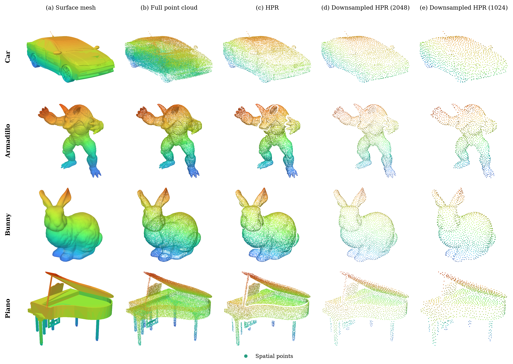
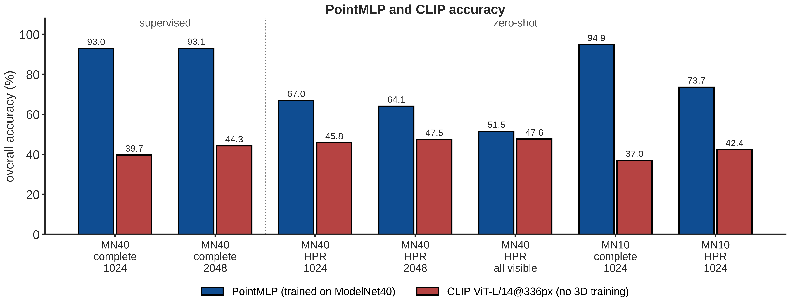
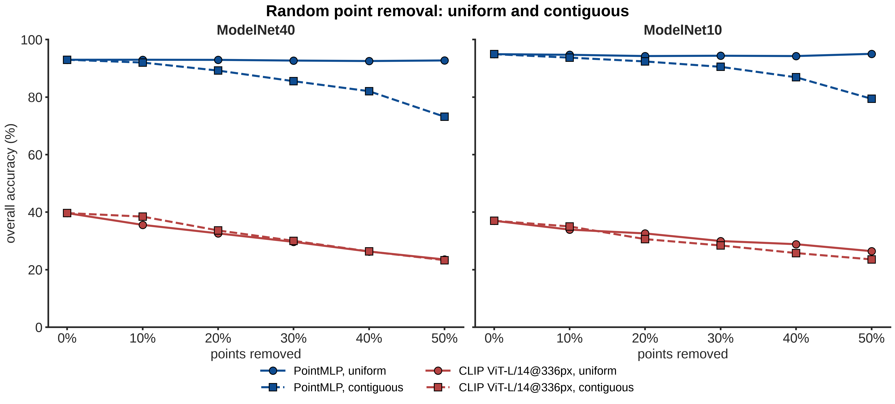
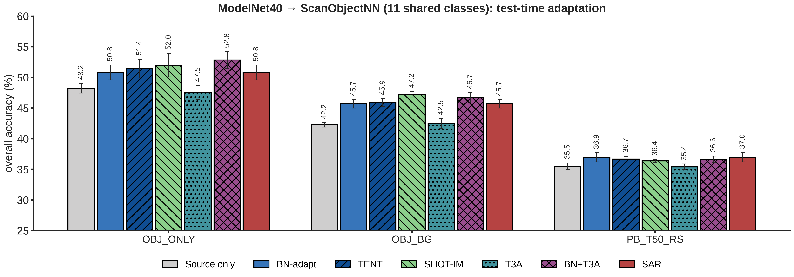

# Point Cloud Classification Under Distribution Shift: Partial Views, Missing Points and Real Scans

Workshop project `cad-to-scan-pointmlp`.

Workshop material for 3D object classification on ModelNet40 with PointMLP.

- Point cloud data preparation: single-view test sets with Hidden Point Removal (HPR), random point removal test sets, ScanObjectNN
- Data visualisation
- Model training
- Model testing (supervised and zero-shot) and test-time adaptation (ModelNet40 → ScanObjectNN)



## Results

PointMLP checkpoint `checkpoints/pointMLP_baseline_best.pth` (300 epochs on ModelNet40).

| Setting | Test set | Objects | PointMLP OA | PointMLP mAcc | CLIP OA |
|---|---|---|---|---|---|
| Supervised | ModelNet40, complete, 1024 pts | 2468 | 92.99 | 89.57 | 39.67 |
| Supervised | ModelNet40, complete, 2048 pts | 2468 | 93.07 | 89.92 | 44.29 |
| Zero-shot | ModelNet40, HPR, 1024 pts | 2468 | 66.98 | 65.80 | 45.83 |
| Zero-shot | ModelNet40, HPR, 2048 pts | 2468 | 64.10 | 62.96 | 47.49 |
| Zero-shot | ModelNet40, HPR, all visible points | 2468 | 51.54 | 48.37 | 47.65 |
| Zero-shot | ModelNet10, complete, 1024 pts | 908 | 94.93 | 94.86 | 37.00 |
| Zero-shot | ModelNet10, HPR, 1024 pts | 908 | 73.68 | 73.14 | 42.40 |

- Supervised: complete ModelNet40 test objects.
- Zero-shot:
  - single-view HPR test objects;
  - ModelNet10, using the ModelNet10 classes of the 40-class output.
- CLIP: ViT-L/14@336px, PointCLIP-style depth-map projection with 9 views. Backbone and background were selected on 400 training objects.



### Random point removal

Applied to the test sets only (1024 points per object):

- uniform: randomly chosen points are removed over the whole object, so it becomes evenly sparser;
- contiguous: a random point and its nearest neighbours are removed, leaving one ball-shaped hole.

| Dataset | Removal | PointMLP OA | CLIP OA |
|---|---|---|---|
| ModelNet40 | complete | 92.99 | 39.67 |
| ModelNet40 | uniform 10% | 92.99 | 35.58 |
| ModelNet40 | uniform 20% | 92.95 | 32.62 |
| ModelNet40 | uniform 30% | 92.71 | 29.66 |
| ModelNet40 | uniform 40% | 92.54 | 26.30 |
| ModelNet40 | uniform 50% | 92.75 | 23.54 |
| ModelNet40 | contiguous 10% | 92.02 | 38.45 |
| ModelNet40 | contiguous 20% | 89.22 | 33.63 |
| ModelNet40 | contiguous 30% | 85.53 | 30.02 |
| ModelNet40 | contiguous 40% | 82.05 | 26.34 |
| ModelNet40 | contiguous 50% | 73.18 | 23.30 |
| ModelNet10 | complete | 94.93 | 37.00 |
| ModelNet10 | uniform 10% | 94.71 | 33.92 |
| ModelNet10 | uniform 20% | 94.27 | 32.60 |
| ModelNet10 | uniform 30% | 94.38 | 29.96 |
| ModelNet10 | uniform 40% | 94.27 | 28.85 |
| ModelNet10 | uniform 50% | 95.04 | 26.43 |
| ModelNet10 | contiguous 10% | 93.72 | 35.02 |
| ModelNet10 | contiguous 20% | 92.40 | 30.62 |
| ModelNet10 | contiguous 30% | 90.53 | 28.41 |
| ModelNet10 | contiguous 40% | 86.89 | 25.77 |
| ModelNet10 | contiguous 50% | 79.41 | 23.57 |



### Test-time adaptation, ModelNet40 → ScanObjectNN

PointMLP trained on ModelNet40, tested on real scans (11 shared classes, 475 / 475 / 2362 objects).
Overall accuracy (%), mean of 3 seeds; in brackets the gain over source only, * = 95% paired bootstrap CI excludes 0.

| ScanObjectNN | Source only | BN-adapt | TENT | SHOT-IM | T3A | BN+T3A | SAR |
|---|---|---|---|---|---|---|---|
| OBJ_ONLY | 48.2 | 50.8 (+2.6) | 51.4 (+3.2) | 52.0 (+3.8*) | 47.5 (-0.7) | 52.8 (+4.6*) | 50.8 (+2.6) |
| OBJ_BG | 42.2 | 45.7 (+3.4*) | 45.9 (+3.6*) | 47.2 (+5.0*) | 42.5 (+0.2) | 46.7 (+4.4*) | 45.7 (+3.4*) |
| PB_T50_RS | 35.5 | 36.9 (+1.5*) | 36.7 (+1.2*) | 36.4 (+0.9) | 35.4 (-0.1) | 36.6 (+1.1*) | 37.0 (+1.5*) |

- One pass over the test stream, batches of 64, model reset for every run; labels are used only for scoring.
- BN-adapt: test-batch BatchNorm statistics. TENT: entropy minimisation of the BatchNorm affine parameters.
  SHOT-IM: entropy minimisation and diversity, all layers except the classifier. T3A: prototype classifier from test features.
  SAR: entropy minimisation on reliable samples with sharpness-aware updates.
- ScanObjectNN `cabinet` is scored with the highest of the dresser, night stand and wardrobe outputs; `display` with monitor, `shelf` with bookshelf.



## Reproduce

```bash
git clone https://github.com/akayedackerman/cad-to-scan-pointmlp.git
cd cad-to-scan-pointmlp

# 1. environment
conda env create -f environment.yml
conda activate cad-to-scan
pip install reference/pointMLP-pytorch/pointnet2_ops_lib/.   # optional: CUDA farthest-point sampling (as in the official PointMLP training)

# 2. data and trained model
bash scripts/download_data.sh          # ModelNet40 and ModelNet10 (ScanObjectNN: see below)
bash scripts/download_checkpoint.sh    # PointMLP, 300 epochs on ModelNet40 (GitHub release v1.0)

# 3. all experiments, figures and tables
bash run_all.sh                        # ~1 h 45 min on one GPU (CLIP ~1 h 20 min); SKIP_CLIP=1 bash run_all.sh: ~25 min
```

ScanObjectNN is distributed by its authors after accepting their terms of use
([ScanObjectNN](https://hkust-vgd.github.io/scanobjectnn/)). Extract `h5_files.zip` to `data/raw/ScanObjectNN/h5_files/`.

Expected layout:

```
data/raw/ModelNet40/<class>/{train,test}/*.off
data/raw/ModelNet10/<class>/{train,test}/*.off
data/raw/ScanObjectNN/h5_files/{main_split,main_split_nobg}/test_objectdataset*.h5
data/raw/stanford/{armadillo,bunny}.off      # optional, one figure (Stanford 3D Scanning Repository, Z-up)
checkpoints/pointMLP_baseline_best.pth
```

To train PointMLP from scratch instead of downloading the checkpoint, see [Training](#training).
CLIP weights are downloaded automatically on first use.

## Usage

```bash
bash run_all.sh                      # data preparation, visualisation, testing, plots
SKIP_CLIP=1 bash run_all.sh          # without CLIP
```

Individual scripts:

```bash
python scripts/prepare_data.py          # point clouds from meshes
python scripts/make_hpr_testset.py      # HPR test sets
python scripts/make_removal_sets.py     # random point removal test sets
python scripts/prepare_scanobjectnn.py  # ScanObjectNN test sets (11 classes, Z-up)
python scripts/visualize.py             # figures
python scripts/visualize_select.py      # figure of your choice (asks for dataset, objects, figure, style, camera)
python scripts/test_supervised.py       # supervised evaluation
python scripts/test_zeroshot.py         # zero-shot evaluation (HPR, ModelNet10, random point removal)
python scripts/test_zeroshot_clip.py    # CLIP
python scripts/test_tta.py              # test-time adaptation on ScanObjectNN
python scripts/make_plots.py            # result plots, PNG (300 dpi) and PDF in outputs/figures/plots/
```

The result plots follow the publication style of [figures4papers](https://github.com/ChenLiu-1996/figures4papers)
(sans-serif fonts, a fixed blue/green/red palette, black bar edges and hatching that stay readable in greyscale).

## Configuration and logs

Each stage has its own configuration file. The bash scripts only call the Python scripts in order, and every setting is in YAML:

| File | Used by | Contents |
|---|---|---|
| `configs/data.yaml` | `prepare_data.py`, `make_hpr_testset.py`, `make_removal_sets.py`, `prepare_scanobjectnn.py` | point counts, HPR camera and radius, removal methods and ratios, seeds |
| `configs/train.yaml` | `train_pointmlp.py`, `train.sh` | model, optimiser, schedule, augmentation |
| `configs/test.yaml` | `test_supervised.py`, `test_zeroshot.py`, `test_zeroshot_clip.py`, `test_tta.py` | checkpoint, test sets, CLIP views, TTA methods and hyperparameters |

`data.yaml` and `test.yaml` have one section per script. Every value can be overridden on the command line, and
`--config` selects another file (`python scripts/<script>.py --help` lists the options):

```bash
python scripts/make_hpr_testset.py --gamma 2 --datasets modelnet40
python scripts/make_removal_sets.py --methods contiguous --ratios 20 40
python scripts/test_supervised.py --checkpoint checkpoints/other.pth
python scripts/test_tta.py --seeds 0 --methods tent sar
DATA_CONFIG=my_data.yaml TEST_CONFIG=my_test.yaml bash run_all.sh
```

At start, each script prints the configuration it uses. All its output is then written with timestamps to the console and to
`outputs/logs/<script>.log`; each run is appended as a new block:

```
2026-11-15 16:21:02 | INFO  | prepare_data  (config: configs/data.yaml, section: modelnet)
2026-11-15 16:21:02 | INFO  |   {dense_points: 32768, train_points: 2048, workers: 16, force: false}
2026-11-15 16:22:14 | INFO  | modelnet40: 2468 objects | visible 11781 / 32768 points on average (36.0%; ...)
```

Training logs go to `outputs/training/<run_name>/` (see [Training](#training)).

The notebook `notebooks/Workshop_PointCloud_Classification.ipynb` covers the same material. It runs small examples
(sampling, HPR, point removal, predictions, CLIP, test-time adaptation) and loads the results written by `run_all.sh`; it is stored with its outputs.

## Training

Configuration: `configs/train.yaml`.

| Setting | Value |
|---|---|
| Epochs | 300 |
| Batch size | 32 |
| Points per object | 1024 |
| Optimiser | SGD, lr 0.1, momentum 0.9, weight decay 2e-4 |
| LR schedule | cosine to 0.005 |
| Label smoothing | 0.2 |
| Gradient clipping | 1.0 |
| Augmentation | random scale and shift |

```bash
bash train.sh                                    # start in the background
tail -f outputs/training/pointmlp_modelnet40_300ep/train.log
kill $(cat outputs/training/pointmlp_modelnet40_300ep/train.pid)
RESUME=1 bash train.sh                           # resume
bash train.sh configs/train.yaml --epochs 100 --batch_size 16 --run_name run2
GPU=1 bash train.sh
python scripts/train_pointmlp.py --config configs/train.yaml   # foreground
```

Each run writes these files to `outputs/training/<run_name>/`:

- `config.yaml`
- `log.csv`
- `curves.png`
- `best.pth`
- `last.pth`
- `train.log`

To test another checkpoint, set `checkpoint` in `configs/test.yaml` or pass `--checkpoint` to the test scripts.

## Data

Settings: `configs/data.yaml`. Point clouds are sampled uniformly on the mesh surfaces and normalised to the unit sphere. ModelNet meshes are Z-up and are used without rotation.

HPR (Katz et al., 2007):

| Parameter | Value |
|---|---|
| Camera distance | 4 |
| Azimuth | 45/135/225/315° ± 15° |
| Elevation | 15–30° |
| Radius | max‖p − c‖ · 10³ |

On average 36% of the 32,768 points are visible.

Figures (`scripts/visualize.py`, colour and greyscale):

- `hpr_*.png`: mesh, full point cloud (65,536 points), HPR, HPR FPS 2048, HPR FPS 1024, for ModelNet40, ModelNet10, and car / armadillo / bunny / piano;
- `removal_*.png`: complete cloud, uniform and contiguous removal at 10 / 30 / 50%;
- `scanobjectnn_*.png`: OBJ_ONLY, OBJ_BG and PB_T50_RS examples;
- `gallery_*.png`: one test object per class, complete and single-view HPR (1024 points), ModelNet40 and ModelNet10;
- one camera per object, with HPR computed from that camera.

`scripts/visualize_select.py` builds the same figures for objects you choose; all options can also be given as flags, e.g.
`python scripts/visualize_select.py --dataset modelnet40 --objects chair piano_0232 --figure hpr --style both --views auto 40,20`.

| File (`data/processed/`) | Content |
|---|---|
| `modelnet40_train_2048.h5` | 9843 × 2048 |
| `modelnet40_test_32768.h5` | 2468 × 32768 |
| `modelnet40_test_full_{1024,2048}.h5` | complete objects, FPS |
| `modelnet40_test_hpr_{1024,2048}.h5` | HPR, FPS, normalised |
| `modelnet40_test_hpr_raw.h5` | HPR, all visible points (`points`, `offsets`) |
| `modelnet10_test_*` | same for ModelNet10 (908 objects) |
| `<dataset>_test_removal_{uniform,contiguous}_{10..50}.h5` | random point removal, 1024 − removed points |
| `scanobjectnn_{obj_only,obj_bg,pb_t50_rs}.h5` | ScanObjectNN, 11 shared classes, 2048 points, Z-up |

## Layout

```
configs/      data.yaml, train.yaml, test.yaml (data preparation, training, testing)
environment.yml, requirements.txt   dependencies
CITATIONS.bib                        BibTeX of the methods and datasets used
scripts/      data and checkpoint download, data preparation, visualisation, training, testing, plots
src/          model, data utilities, evaluation, CLIP classifier, test-time adaptation, rendering, configuration
notebooks/    workshop notebook
reference/    pointnet2_ops CUDA extension from the PointMLP repository (Apache-2.0)
docs/         figures shown in this README
outputs/      figures, plots, logs and results written by the scripts (not tracked)
```

## Citation

This project builds on the following work. If you use it, please cite them (BibTeX in [`CITATIONS.bib`](CITATIONS.bib)).

| Used for | Reference |
|---|---|
| Model | X. Ma, C. Qin, H. You, H. Ran, Y. Fu. *Rethinking Network Design and Local Geometry in Point Cloud: A Simple Residual MLP Framework (PointMLP).* ICLR 2022. [Code](https://github.com/ma-xu/pointMLP-pytorch) |
| Dataset | Z. Wu et al. *3D ShapeNets: A Deep Representation for Volumetric Shapes (ModelNet).* CVPR 2015. |
| Dataset | M. A. Uy, Q.-H. Pham, B.-S. Hua, D. T. Nguyen, S.-K. Yeung. *Revisiting Point Cloud Classification: A New Benchmark Dataset and Classification Model on Real-World Data (ScanObjectNN).* ICCV 2019. |
| Partial views | S. Katz, A. Tal, R. Basri. *Direct Visibility of Point Sets (HPR).* SIGGRAPH 2007. |
| Zero-shot | A. Radford et al. *Learning Transferable Visual Models From Natural Language Supervision (CLIP).* ICML 2021. |
| Zero-shot | R. Zhang et al. *PointCLIP: Point Cloud Understanding by CLIP.* CVPR 2022. |
| Zero-shot | X. Zhu et al. *PointCLIP V2: Prompting CLIP and GPT for Powerful 3D Open-world Learning.* ICCV 2023. |
| TTA | S. Schneider et al. *Improving Robustness Against Common Corruptions by Covariate Shift Adaptation (BN-adapt).* NeurIPS 2020. |
| TTA | D. Wang, E. Shelhamer, S. Liu, B. Olshausen, T. Darrell. *Tent: Fully Test-Time Adaptation by Entropy Minimization.* ICLR 2021. |
| TTA | J. Liang, D. Hu, J. Feng. *Do We Really Need to Access the Source Data? (SHOT).* ICML 2020. |
| TTA | Y. Iwasawa, Y. Matsuo. *Test-Time Classifier Adjustment Module for Model-Agnostic Domain Generalization (T3A).* NeurIPS 2021. |
| TTA | S. Niu et al. *Towards Stable Test-Time Adaptation in Dynamic Wild World (SAR).* ICLR 2023. |
| Figure | The Stanford 3D Scanning Repository (Armadillo, Bunny). |

`src/pointmlp.py` follows the official PointMLP implementation, and `reference/pointMLP-pytorch/pointnet2_ops_lib`
is taken from the official repository (Apache-2.0, see its `LICENSE`).

## License

MIT, see [`LICENSE`](LICENSE). `reference/pointMLP-pytorch/pointnet2_ops_lib` is from the official PointMLP repository
and keeps its Apache-2.0 license (`reference/pointMLP-pytorch/LICENSE`). The datasets (ModelNet, ScanObjectNN,
Stanford 3D Scanning Repository) are not included and are subject to their own terms of use.
